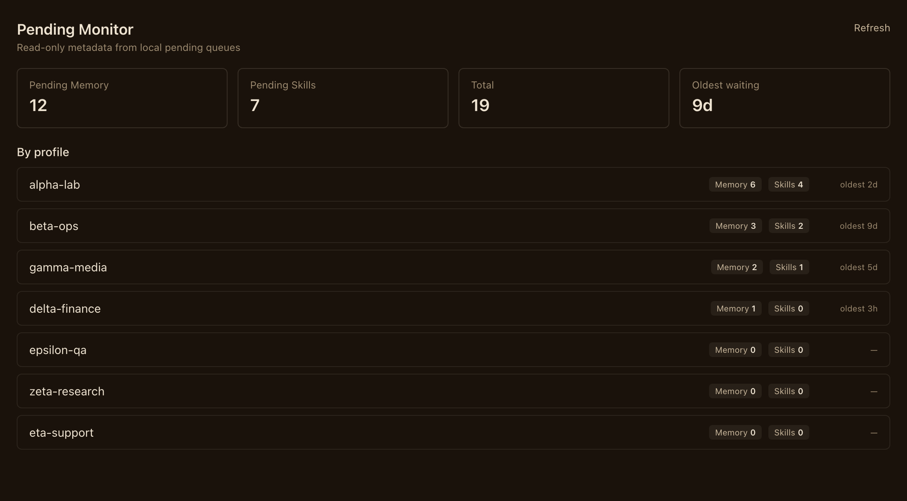

# Pending Queue Monitor

Pending Queue Monitor is a local-only, read-only Hermes Desktop plugin. It adds a
**Pending Monitor** page and a command-palette command for viewing pending memory
and skill write approvals.

It reads only the default Hermes root's `pending/memory/*.json` and
`pending/skills/*.json`, plus the same directories in immediate named profile
directories that contain `config.yaml`. By design, the monitor aggregates all
profiles under the default Hermes root; it is not limited to the currently
selected Desktop profile. It uses the public Hermes path helpers at request time
and rejects symlinks, hardlinks, and paths that resolve outside the owning profile
home.

The API returns counts, age buckets, oldest age, and these item fields only:
`profile`, `subsystem`, `id`, `action`, `origin`, `created_at`, and `age_seconds`.
It never returns or displays summaries, payloads, content, `old_text`, operations,
or any other pending record data. There are no approve, reject, or delete actions.
Unreadable, malformed, or disappearing files are skipped and counted. Each file is
limited to 1 MiB and the response returns at most 1,000 valid items; `truncated: true`
means additional valid records were found. IDs, actions, and origins must be
printable strings no longer than 256 characters.

## Screenshot



Rendered with sample data; profile names and counts are illustrative.

## Install and enable

Place this directory under the Hermes plugins directory, then enable
`pending-queue-monitor` through the normal Hermes plugin flow. The Python backend
is gated by `plugins.enabled` in `~/.hermes/config.yaml`, for example:

```yaml
plugins:
  enabled:
    - pending-queue-monitor
```

Restart the serve child (or Hermes Desktop) so the backend mounts, then use the
Desktop command palette's **Reload desktop plugins** step if the renderer is not
visible. The backend must be mounted by Hermes for the page to show data.
For a local development checkout, run `hermes plugins validate
/path/to/pending-queue-monitor` before enabling it.

This package makes no network calls, writes no files, and does not modify Hermes
configuration. The view is a snapshot refreshed every 30 seconds or manually. It
does not guarantee a file will remain present between scanning and a later review.

## Data access and platform support

The backend reads pending metadata outside the plugin package: `pending/memory/`
and `pending/skills/` under the default Hermes root and immediate named profiles
that contain `config.yaml`. The returned allowlist is limited to the fields listed
above; no pending payload or approval text is exposed. On platforms without
`O_NOFOLLOW`, record files are skipped rather than opened. The Catalog entry should
currently declare macOS only, the platform verified in this preparation; Linux
should be added only after a Linux validation run. Windows is not supported.

The web dashboard manifest declares the plugin tab hidden because this package has
no web `dist` bundle; the visible UI is the unified Desktop `desktop/plugin.js`
surface. A valid no-op dashboard entry is retained to satisfy the manifest loader.

## Test and verify

From this directory, run the commands below in a Python environment with FastAPI
and pytest installed (for example, the Hermes-managed Python environment):

```bash
python -m pytest -q tests
python -c 'import ast, pathlib; [ast.parse(pathlib.Path(p).read_text()) for p in ("dashboard/plugin_api.py", "tests/test_plugin_api.py")]'
node --input-type=module --check < desktop/plugin.js
hermes plugins validate .
```
